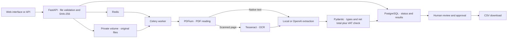

# Intelligent Document Processing for Invoices

This proof of concept turns a supplier invoice into a verified CSV row. Upload a PDF, JPEG, or PNG. The app reads the PDF text or runs OCR on scanned pages, then displays seven extracted header fields and the line table next to a preview of the invoice. Each line is checked: quantity × unit price, less any discount, must match the printed amount, and the lines must add up to the net total. Select a field or a line to see the zone it was read from. Review and correct the values, approve the invoice, and download the CSV files. The app warns about a second copy of an invoice already imported, and measures review time and extraction accuracy against the approved values.

The local mode uses **Tesseract and rule-based extraction** and runs without an account or API key. The optional OpenAI mode uses structured outputs and sends scanned page images to the configured model.

## Run with Docker Compose

You need Docker with the Compose plugin and access to this GitHub repository.

```bash
git clone https://github.com/e-jaafar/intelligent-document-processing.git
cd intelligent-document-processing
docker compose up --build
```

Open the [web interface](http://127.0.0.1:8000) or the [interactive API docs](http://127.0.0.1:8000/docs). Compose starts FastAPI, a Celery worker, Redis, and PostgreSQL. Docker volumes preserve the documents and their statuses between runs. Use `docker compose down` to stop the services. Adding `--volumes` deletes all demo data.

### Try the example invoices

The invoices in [`examples/`](examples) are synthetic. The interface and CSV column headers are in French.

1. Upload [`facture-native.pdf`](examples/facture-native.pdf). The method is `pdf-texte`. Review the seven fields, select **Valider la facture**, then download the CSV.
2. Upload [`facture-scanee.pdf`](examples/facture-scanee.pdf) or [`facture-scanee.png`](examples/facture-scanee.png). The method is `ocr`. In local mode, recognized fields show a source excerpt and page number. Select a field to frame its zone on the page and show it enlarged. Upload the other format next: it is a second scan of the same invoice, so the app shows it as a possible duplicate and refuses to approve it a second time.
3. Upload [`facture-a-corriger.pdf`](examples/facture-a-corriger.pdf). The invoice shows a gross total of 1,200.00, a net total of 1,000.00, and VAT of 210.00. The app blocks approval. For this synthetic example, change **Total TTC** to `1210,00` and approve. Upload the same file again to see the duplicate check.
4. Upload [`facture-lignes-2-pages.pdf`](examples/facture-lignes-2-pages.pdf). Its 46-line table continues on page 2, with *A reporter* and *Report* carry-forward rows that are skipped, and two lines discounted by 10 %. Select **p. 2** in the **Source** column to show the page a line comes from.
5. Upload [`facture-ecart-ligne.pdf`](examples/facture-ecart-ligne.pdf). Line 1 prints 54,40 for 12 × 4,20, so the row is highlighted and approval is blocked. Correcting the amount to `50,40` then reveals that the lines no longer add up to the printed net total. When the original invoice really contains the error, tick **Les écarts figurent sur la facture originale** to approve it as printed. The accepted differences are kept in the CSV.
6. Upload [`avoir.pdf`](examples/avoir.pdf). This credit note keeps its negative quantities and amounts in both CSV files.

The invoice download contains one invoice row in UTF-8, with comma separators, an ISO date, and a period as the decimal separator. The first example produces this CSV after approval.

```csv
Numéro de facture,Fournisseur,Date de facture,Devise,Total HT,TVA,Total TTC,Écarts acceptés
DEMO-001,Atelier Exemple SRL,2026-11-12,EUR,1000.00,210.00,1210.00,
```

When the invoice has lines, **CSV des lignes** downloads one row per line, joined to the invoice by its number. The discount column is a percentage, and the last column is quantity × unit price less the discount, to compare with the printed amount.

```csv
Numéro de facture,Ligne,Description,Quantité,Prix unitaire,Remise (%),Montant,Montant calculé
DEMO-004,4,Cheville nylon 8 mm - lot 4,26,0.09,10,2.11,2.11
```

## How it works



- **Upload.** The server checks the actual file format, allows files up to 10 MiB and PDFs up to 10 pages, and identifies byte-for-byte duplicates using SHA-256, which returns the existing document. A different file of the same invoice, such as a second scan, is detected after extraction by its supplier and invoice number, compared without case, spaces or punctuation. The review screen links to the other copies, and the database refuses a second approved invoice with the same supplier and number.
- **Read.** PDFium reads native PDF text. Tesseract reads images and PDF pages with fewer than 25 alphanumeric characters in their text layer.
- **Extract.** In local mode, rules recognize common French and English labels. Conflicting values are left blank. Approval requires an invoice number, supplier, date, currency, net total, VAT amount, and gross total.
- **Extract lines.** In local mode, the line table starts at a header row naming a description and an amount column, may continue on later pages, and ends at the net or gross total. Each row reads *description, quantity, unit price, optional discount %, net amount*, which is the layout of the pilot supplier. Carry-forward rows are skipped. Rows whose description wraps onto a second line are not recognized yet. When a column is misread, for example a grouped number, the arithmetic check flags the row.
- **Validate.** Pydantic normalizes dates, currency, and amounts. The POC accepts invoices in EUR. Amounts may be negative, which is how credit notes are exported. The checks use `Decimal` and allow a one-cent difference for each line (quantity × unit price × (1 − discount), rounded half up), for the sum of the lines against the net total, and for net total plus VAT against the gross total. Any difference blocks approval, unless the bookkeeper confirms that it is printed on the original invoice. The accepted differences are stored with the approval and exported. Missing VAT requires an explicit entry during review.
- **Review.** Every extracted invoice goes through human review. In local mode, each field and line keeps the box of the text line it was read from, from PDFium character boxes or Tesseract word boxes. Selecting a field or a line frames that box on the page and shows the zone enlarged. The app stores the extracted values separately from the approved values. Repeated downloads of an approved invoice produce the same CSV. Text values that could be interpreted as spreadsheet formulas are escaped.
- **Retry.** Use the interface to retry a failed extraction. A task still queued or processing after five minutes also becomes eligible for retry. Each attempt has an ID that prevents an older task from overwriting a newer result.

| Status | Available action |
|---|---|
| `queued` / `processing` | View the invoice preview and follow progress. |
| `review` | Review, correct, and approve the invoice. |
| `approved` | Download the CSV. |
| `failed` | Read the error message and retry. |

## Enable OpenAI extraction

Copy `.env.example` to `.env`. Set `OPENAI_API_KEY` and set `OPENAI_MODEL` to a model available to your account that supports image inputs and structured outputs. Restart with `docker compose up --build -d`.

This mode sends page text and images of pages processed by OCR to OpenAI. It uses the same invoice fields as local mode and requests `null` for missing or unreadable values. Each invoice still requires human approval. The app shows `openai-texte` or `openai-vision` and displays token usage when returned by the provider. Use the synthetic examples when trying this mode. API usage may incur charges. [Structured outputs](https://developers.openai.com/api/docs/guides/structured-outputs) · [Image inputs](https://developers.openai.com/api/docs/guides/images-vision)

## API

| Method and path | Purpose |
|---|---|
| `POST /documents` | Upload using the multipart `file` field. Returns `202` with the document ID and the `duplicate` flag. |
| `GET /documents` | List the 100 most recently updated documents. |
| `GET /documents/{id}` | Get the status, fields, local source excerpts with their page boxes, validation notes, possible duplicates, corrections, review time, duration, and retry eligibility. |
| `GET /documents/{id}/preview/{page}` | Get a PNG preview. Page numbering starts at 1. |
| `POST /documents/{id}/retry` | Retry a failed or stalled attempt. |
| `POST /documents/{id}/approve` | Approve a JSON payload with `attempt` and, under `invoice`, the seven fields plus an optional `lines` list of `description`, `quantity`, `unit_price`, `discount_percent`, and `amount`. Send numbers as strings. Set `accept_discrepancies` to approve differences printed on the original, and `review_ms` to record the review time. |
| `GET /documents/{id}/export.csv` | Download the CSV for an approved invoice. |
| `GET /documents/{id}/lines.csv` | Download the line CSV for an approved invoice. |
| `GET /metrics` | Get review time and extraction accuracy over approved invoices. |
| `GET /metrics.csv` | Download one metrics row per approved invoice. |

```bash
curl -F "file=@examples/facture-native.pdf" http://127.0.0.1:8000/documents
```

## Local development and tests

To run without Docker, install Python 3.13 and Tesseract with the English language data. This mode uses SQLite and processes documents during the upload request. In Compose, the API returns the upload response while a separate worker processes the document.

```bash
python3.13 -m venv .venv
source .venv/bin/activate
python -m pip install -r requirements-dev.txt
CELERY_EAGER=1 python -m uvicorn app.main:app --host 127.0.0.1 --port 8000
```

Run `python -m pytest -q tests` in the same virtual environment. The tests use real PDF and PNG files, Tesseract, a temporary database, and a simulated extraction failure to check retries. To test the asynchronous stack, start Compose with fresh test volumes and run `IDP_TEST_URL=http://127.0.0.1:8000 python -m pytest -q tests`. GitHub Actions runs both paths. Run `python examples/generate.py` to regenerate the fixtures.

| Path | Responsibility |
|---|---|
| `app/main.py` | HTTP API, review, and CSV export |
| `app/tasks.py` | Celery processing and retry state |
| `app/extraction.py` | PDFium, Tesseract, and optional OpenAI extraction |
| `app/invoice.py` | Invoice fields and validation rules |
| `app/db.py` | Persistence |
| `app/static/` | Web interface |

## Metrics and scope

The **Mesures** panel compares each approved invoice with what was extracted, so the approved values serve as labels.

- **Review time.** The interface counts the time an invoice spends open in review while the page is visible, and sends it with the approval. Enter the bookkeeper's current time per invoice under **Temps actuel par facture** to compare the median. The value is kept in the browser.
- **Accuracy.** For each header field, the share of approved invoices whose extracted value was kept. For lines, the share of approved lines that were extracted exactly. *Sans correction* is the share of invoices approved without any change.
- **Detail.** **Détail par facture (CSV)** lists, for each invoice, the method, the extraction and review times, the corrected fields, the line counts, and the accepted differences.

These measures are only as good as the review: a value approved without checking counts as correct. The interface also shows extraction time and, in OpenAI mode, token usage. Cost per invoice requires the rates for the selected model. Every invoice is still reviewed manually.

This demo is designed for local use with test documents. It has no authentication or tenant isolation. The CSV uses a generic format and has yet to be tested against a live ERP. Line descriptions that wrap onto several rows, layouts from other suppliers, rotated pages, contracts, batch uploads, and automatic exports are outside the current scope. Source boxes are not available in OpenAI mode.
