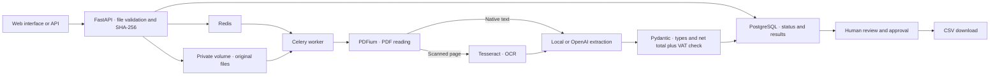

# Intelligent Document Processing for Invoices

This proof of concept turns a supplier invoice into a verified CSV row. Upload a PDF, JPEG, or PNG. The app reads the PDF text or runs OCR on scanned pages, then displays seven extracted fields next to a preview of the invoice. Review and edit the values, approve the invoice, and download the CSV.

The local mode uses **Tesseract and rule-based extraction** and runs without an account or API key. The optional OpenAI mode uses structured outputs and sends scanned page images to the configured model.

## Run with Docker Compose

You need Docker with the Compose plugin and access to this GitHub repository.

```bash
git clone https://github.com/e-jaafar/intelligent-document-processing.git
cd intelligent-document-processing
docker compose up --build
```

Open the [web interface](http://127.0.0.1:8000) or the [interactive API docs](http://127.0.0.1:8000/docs). Compose starts FastAPI, a Celery worker, Redis, and PostgreSQL. Docker volumes preserve the documents and their statuses between runs. Use `docker compose down` to stop the services. Adding `--volumes` deletes all demo data.

### Try three invoices

The invoices in [`examples/`](examples) are synthetic. The interface and CSV column headers are in French.

1. Upload [`facture-native.pdf`](examples/facture-native.pdf). The method is `pdf-texte`. Review the seven fields, select **Valider la facture**, then download the CSV.
2. Upload [`facture-scanee.pdf`](examples/facture-scanee.pdf) or [`facture-scanee.png`](examples/facture-scanee.png). The method is `ocr`. In local mode, recognized fields show a source excerpt and page number.
3. Upload [`facture-a-corriger.pdf`](examples/facture-a-corriger.pdf). The invoice shows a gross total of 1,200.00, a net total of 1,000.00, and VAT of 210.00. The app blocks approval. For this synthetic example, change **Total TTC** to `1210,00` and approve. Upload the same file again to see the duplicate check.

Each download contains one invoice row in UTF-8, with comma separators, an ISO date, and a period as the decimal separator. The first example produces this CSV after approval.

```csv
Numéro de facture,Fournisseur,Date de facture,Devise,Total HT,TVA,Total TTC
DEMO-001,Atelier Exemple SRL,2026-11-12,EUR,1000.00,210.00,1210.00
```

## How it works



- **Upload.** The server checks the actual file format, allows files up to 10 MiB and PDFs up to 10 pages, and identifies byte-for-byte duplicates using SHA-256. Two different scans of the same invoice can create two entries.
- **Read.** PDFium reads native PDF text. Tesseract reads images and PDF pages with fewer than 25 alphanumeric characters in their text layer.
- **Extract.** In local mode, rules recognize common French and English labels. Conflicting values are left blank. Approval requires an invoice number, supplier, date, currency, net total, VAT amount, and gross total.
- **Validate.** Pydantic normalizes dates, currency, and amounts. The POC accepts invoices in EUR with nonnegative amounts. The check uses `Decimal` and allows a one-cent difference between net total plus VAT and the gross total. Missing VAT requires an explicit entry during review.
- **Review.** Every extracted invoice goes through human review. The app stores the extracted values separately from the approved values. Repeated downloads of an approved invoice produce the same CSV. Text values that could be interpreted as spreadsheet formulas are escaped.
- **Retry.** Use the interface to retry a failed extraction. A task still queued or processing after five minutes also becomes eligible for retry. Each attempt has an ID that prevents an older task from overwriting a newer result.

| Status | Available action |
|---|---|
| `queued` / `processing` | View the invoice preview and follow progress. |
| `review` | Review, correct, and approve the invoice. |
| `approved` | Download the CSV. |
| `failed` | Read the error message and retry. |

## Enable OpenAI extraction

Copy `.env.example` to `.env`. Set `OPENAI_API_KEY` and set `OPENAI_MODEL` to a model available to your account that supports image inputs and structured outputs. Restart with `docker compose up --build -d`.

This mode sends page text and images of pages processed by OCR to OpenAI. It uses the same invoice fields as local mode and requests `null` for missing or unreadable values. Each invoice still requires human approval. The app shows `openai-texte` or `openai-vision` and displays token usage when returned by the provider. Use the synthetic examples when trying this mode. API usage may incur charges. [Structured outputs](https://developers.openai.com/api/docs/guides/structured-outputs) · [Image inputs](https://developers.openai.com/api/docs/guides/images-vision)

## API

| Method and path | Purpose |
|---|---|
| `POST /documents` | Upload using the multipart `file` field. Returns `202` with the document ID and the `duplicate` flag. |
| `GET /documents` | List the 100 most recently updated documents. |
| `GET /documents/{id}` | Get the status, fields, local source excerpts, validation notes, duration, and retry eligibility. |
| `GET /documents/{id}/preview/{page}` | Get a PNG preview. Page numbering starts at 1. |
| `POST /documents/{id}/retry` | Retry a failed or stalled attempt. |
| `POST /documents/{id}/approve` | Approve a JSON payload with `attempt` and the seven fields under `invoice`. Send amounts as strings. |
| `GET /documents/{id}/export.csv` | Download the CSV for an approved invoice. |

```bash
curl -F "file=@examples/facture-native.pdf" http://127.0.0.1:8000/documents
```

## Local development and tests

To run without Docker, install Python 3.13 and Tesseract with the English language data. This mode uses SQLite and processes documents during the upload request. In Compose, the API returns the upload response while a separate worker processes the document.

```bash
python3.13 -m venv .venv
source .venv/bin/activate
python -m pip install -r requirements-dev.txt
CELERY_EAGER=1 python -m uvicorn app.main:app --host 127.0.0.1 --port 8000
```

Run `python -m pytest -q tests` in the same virtual environment. The tests use real PDF and PNG files, Tesseract, a temporary database, and a simulated extraction failure to check retries. To test the asynchronous stack, start Compose with fresh test volumes and run `IDP_TEST_URL=http://127.0.0.1:8000 python -m pytest -q tests`. GitHub Actions runs both paths. Run `python examples/generate.py` to regenerate the fixtures.

| Path | Responsibility |
|---|---|
| `app/main.py` | HTTP API, review, and CSV export |
| `app/tasks.py` | Celery processing and retry state |
| `app/extraction.py` | PDFium, Tesseract, and optional OpenAI extraction |
| `app/invoice.py` | Invoice fields and validation rules |
| `app/db.py` | Persistence |
| `app/static/` | Web interface |

## Metrics and scope

The interface shows extraction time and, in OpenAI mode, token usage. Measuring per-field accuracy and cost per invoice requires a labeled dataset and the rates for the selected model. The POC reviews every invoice manually, so the rate of processing without human intervention is 0%.

This demo is designed for local use with test documents. It has no authentication or tenant isolation. The CSV uses a generic format and has yet to be tested against a live ERP. Line-item extraction, contracts, batch uploads, business-level duplicate detection, and automatic exports are outside the current scope.
