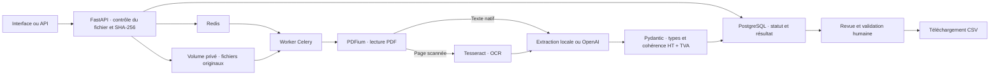

# Intelligent Document Processing · Factures

Ce POC transforme une facture fournisseur en ligne CSV vérifiée. Importez un PDF, un JPEG ou un PNG. L’application lit le texte du PDF ou applique l’OCR aux pages scannées, propose sept champs et les affiche à côté de l’original. Après vérification et correction éventuelle, vous validez la facture et téléchargez le CSV.

Le mode local utilise **Tesseract et des règles d’extraction**. Il fonctionne sans compte ni clé d’API. Le mode OpenAI optionnel utilise une sortie structurée et transmet les images des pages scannées au modèle configuré.

## Démarrer avec Docker Compose

**Prérequis** — Docker avec le plugin Compose.

```bash
git clone https://github.com/e-jaafar/intelligent-document-processing.git
cd intelligent-document-processing
docker compose up --build
```

Ouvrez [l’interface](http://127.0.0.1:8000) ou la [documentation interactive de l’API](http://127.0.0.1:8000/docs). Compose démarre l’API FastAPI, un worker Celery, Redis et PostgreSQL. Les volumes conservent les documents et leurs statuts après l’arrêt. Pour arrêter les services, lancez `docker compose down`. Ajouter `--volumes` efface toutes les données de la démo.

### Démonstration en trois factures

Les fichiers de [`examples/`](examples) sont fictifs.

1. Importez [`facture-native.pdf`](examples/facture-native.pdf). Le résultat indique `pdf-texte`. Vérifiez les sept champs, validez, puis téléchargez le CSV.
2. Importez [`facture-scanee.pdf`](examples/facture-scanee.pdf) ou [`facture-scanee.png`](examples/facture-scanee.png). Le résultat indique `ocr`. Les champs reconnus dans le mode local affichent un extrait et un numéro de page.
3. Importez [`facture-a-corriger.pdf`](examples/facture-a-corriger.pdf). Le document affiche un TTC de 1 200,00 pour un HT de 1 000,00 et une TVA de 210,00. La validation est bloquée. Pour cette démonstration fictive, corrigez le TTC à `1210,00` puis validez. Réimportez le même fichier pour voir la détection du doublon.

Le CSV contient une ligne par téléchargement, avec virgules comme séparateurs, UTF‑8, date ISO et décimales avec point. Exemple de sortie après validation de la première facture.

```csv
Numéro de facture,Fournisseur,Date de facture,Devise,Total HT,TVA,Total TTC
DEMO-001,Atelier Exemple SRL,2026-11-12,EUR,1000.00,210.00,1210.00
```

## Fonctionnement



- **Import.** Le serveur vérifie le format réel, limite l’import à 10 Mio et 10 pages par PDF, et détecte les fichiers identiques par SHA‑256. Deux scans différents d’une même facture peuvent produire deux entrées.
- **Lecture.** PDFium lit le texte natif. Tesseract lit les images et les pages PDF dont le texte natif contient trop peu de caractères alphanumériques. Le seuil actuel est de 25 caractères par page.
- **Extraction.** En mode local, des libellés connus en français et en anglais alimentent les sept champs. Les valeurs contradictoires restent vides. Le numéro de facture, le fournisseur, la date, la devise, le HT, la TVA et le TTC sont obligatoires pour valider.
- **Validation.** Pydantic normalise les dates, la devise et les montants. Le POC accepte des factures positives ou nulles en EUR. Le contrôle utilise `Decimal` et autorise un écart maximal d’un centime entre HT + TVA et TTC. Une TVA manquante exige une vérification et une saisie explicite.
- **Revue.** Chaque facture extraite passe en revue. Le résultat initial et les valeurs approuvées sont conservés séparément. Après validation, le même document fournit le même CSV à chaque téléchargement. L’application neutralise les débuts de formule dans les champs texte du CSV.
- **Reprise.** Une extraction en échec peut être relancée depuis l’interface. Une tâche encore en file ou en cours après cinq minutes devient également relançable. Un identifiant de tentative empêche une ancienne tâche de remplacer un résultat récent.

| Statut | Action possible |
|---|---|
| `queued` / `processing` | Consulter l’aperçu et suivre l’extraction. |
| `review` | Vérifier les champs, corriger, puis valider. |
| `approved` | Télécharger le CSV. |
| `failed` | Consulter le message et relancer. |

## Activer OpenAI

Copiez `.env.example` vers `.env`, renseignez `OPENAI_API_KEY` et `OPENAI_MODEL` avec une clé et un modèle de votre compte qui accepte les images et les sorties structurées. Redémarrez avec `docker compose up --build -d`.

Le mode activé envoie le texte des pages et les images des pages passées par OCR à OpenAI. Il demande le même schéma de champs que le mode local, avec `null` pour les données illisibles ou absentes. La revue humaine reste obligatoire. Le résultat affiche la route `openai-texte` ou `openai-vision` et le nombre de tokens lorsque le fournisseur le renvoie. Utilisez les exemples fictifs pour essayer ce mode. Il peut générer des frais. [Documentation des sorties structurées](https://developers.openai.com/api/docs/guides/structured-outputs) · [Documentation des entrées image](https://developers.openai.com/api/docs/guides/images-vision)

## API

| Méthode et chemin | Usage |
|---|---|
| `POST /documents` | Import multipart, champ `file`. Réponse `202` avec l’identifiant et l’indicateur `duplicate`. |
| `GET /documents` | Liste des 100 documents les plus récemment mis à jour. |
| `GET /documents/{id}` | Statut, champs, sources locales, anomalies, durée et possibilité de relance. |
| `GET /documents/{id}/preview/{page}` | Aperçu PNG, pages numérotées à partir de 1. |
| `POST /documents/{id}/retry` | Relance une tentative en échec ou bloquée. |
| `POST /documents/{id}/approve` | Valide un corps JSON avec `attempt` et les sept champs dans `invoice`. Les montants sont des chaînes. |
| `GET /documents/{id}/export.csv` | Télécharge le CSV d’une facture approuvée. |

```bash
curl -F "file=@examples/facture-native.pdf" http://127.0.0.1:8000/documents
```

## Développement et tests

Pour exécuter la démo locale sans Docker, installez Python 3.13 et Tesseract avec les données anglaises. Ce mode utilise SQLite et exécute le traitement dans la requête d’import. Avec le mode Compose, l’API renvoie la réponse d’import pendant que le worker traite le document.

```bash
python3.13 -m venv .venv
source .venv/bin/activate
python -m pip install -r requirements-dev.txt
CELERY_EAGER=1 python -m uvicorn app.main:app --host 127.0.0.1 --port 8000
```

Dans un terminal avec le même environnement virtuel, lancez `python -m pytest -q tests`. Les tests utilisent de vrais PDF, PNG et appels Tesseract, une base temporaire et un échec d’extraction simulé pour vérifier la relance. Pour tester la pile asynchrone, démarrez Compose avec des volumes de test neufs et lancez `IDP_TEST_URL=http://127.0.0.1:8000 python -m pytest -q tests`. GitHub Actions exécute les deux parcours. Pour régénérer les exemples, utilisez `python examples/generate.py`.

Le code est réparti entre `app/main.py` pour l’API, `app/tasks.py` pour le traitement asynchrone, `app/extraction.py` pour PDFium, Tesseract et OpenAI, `app/invoice.py` pour les règles de facture, `app/db.py` pour la persistance et `app/static/` pour l’interface.

## Mesures et périmètre

L’interface affiche la durée d’extraction et, en mode OpenAI, le volume de tokens. L’exactitude par champ et le coût par facture nécessitent un corpus annoté et les tarifs applicables au modèle. La revue est systématique dans ce POC, donc le taux de traitement sans intervention est de 0 %.

Cette démo est prévue pour un poste local avec des documents de test. Elle n’implémente ni authentification, ni gestion multi-entreprise. Le CSV est générique et l’import dans un ERP réel reste à vérifier. Les lignes de facture, contrats, lots, rapprochements métier et exports automatiques sont des extensions du produit.
